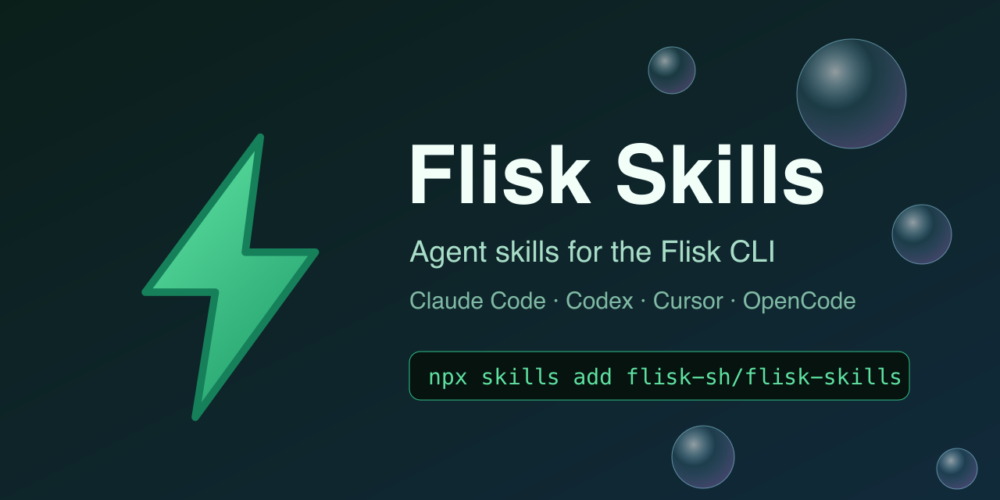

<p align="center"></p>

# Flisk Skills — portable Agent Skills for the Flisk CLI

[](LICENSE)
[](skills)
[](https://agentskills.io/specification)
[](https://skills.sh/flisk-sh/flisk-skills)

English | Skills for coding agents that drive the **local-only** Flisk CLI.

### Stop letting agents guess your local infrastructure.

Coding agents are excellent at writing application logic and terrible at keeping Dockerfiles, Tiltfiles, nginx configs and port assignments consistent. Every hallucinated config burns tokens and developer time.

**Flisk Skills** give agents verified, portable procedures for the Flisk `service.json` contract. Agents run `flisk doctor`, scaffold resources, start stacks with `flisk up`, and diagnose failures using the same commands a human would — without inventing Kubernetes or Compose.

### ⚡ Install in seconds

```bash
curl -fsSL https://flisk.sh/install.sh | sh                                              # 1. CLI
npx skills add flisk-sh/flisk-skills                                                                 # 2. skills
curl -fsSL https://raw.githubusercontent.com/flisk-sh/flisk-skills/main/install.sh | sh -s -- --agent codex   # 2 (alt)
cp rules/AGENTS.landscape.md ./AGENTS.md                                                                # 3. rules template
```

`install.sh` flags: `--agent claude|codex|opencode|cursor|agents`, `--global`, `--project` (default). It only creates symlinks (never copies markdown, never uses `sudo`).

[Website](https://flisk.sh/) · [Agents guide](https://flisk.sh/docs/agents/) · [Quickstart](https://flisk.sh/docs/quickstart/) · [flisk](https://github.com/flisk-sh/flisk) · [skills.sh](https://skills.sh/flisk-sh/flisk-skills) · [Report a bug](https://github.com/flisk-sh/flisk-skills/issues)

If Flisk Skills help your agents, a ⭐ on [this repo](https://github.com/flisk-sh/flisk-skills) helps other developers find them.

## Why Flisk Skills?

- **One canonical copy.** Skills live under `skills/`; the installer and plugin only symlink them.
- **Agent Skills spec.** Each skill has YAML frontmatter (`name`, `description`) that agents use as a trigger.
- **Verified workflows.** Procedures come from real sessions on large stacks (including 100+ service ERP measurements).
- **Local only.** Every skill reinforces that Flisk is Docker + Tilt on your machine, not a deploy tool.

## Skills

| Skill | Use |
|---|---|
| `flisk-doctor` | Check or repair the environment and project config before `flisk up`. |
| `flisk-troubleshoot` | Diagnose a failed `flisk up`, Docker or Tilt session (detailed, measured). |
| `layer-autoresearch` | Contributor experiment loop for the L1-L4 Docker layers (keep/discard). |
| `flisk-scaffold` | Scaffold new backends, frontends, agents and MCP servers. |
| `flisk-generated-files` | Understand and manage `.autogenerated/` files and drift. |
| `flisk-agents` | Run AI agents + MCP tools + database in one local stack. |
| `flisk-ai-agent-build` | Scaffold a complete local agent system (agent + MCP + DB + queue). |
| `flisk-data` | Reset, seed and snapshot local Postgres data. |
| `flisk-databases` | Work with Postgres, Prisma, Drizzle, Atlas, Dbmate. |
| `flisk-benchmark` | Measure container scale, idle memory and start times. |
| `flisk-ports` | Port selection, Traefik routing and localhost URLs. |
| `flisk-upgrade` | Upgrade the CLI and handle generated-file drift. |
| `flisk-byo` | Bring-your-own resources and existing services. |
| `flisk-import-compose` | Import a root docker-compose.yml into Flisk with `flisk import`. |
| `flisk-import-any` | Bring any existing Dockerfile, image or process into Flisk as BYO. |
| `flisk-import-procfile` | Turn Procfile processes into Flisk BYO resources. |
| `flisk-import-helm` | Use Flisk locally next to an existing Helm chart (keep Helm for production). |
| `flisk-secrets` | Project `.env`, params and secrets. |
| `flisk-layout` | Multi-repo layouts and ownership patterns. |
| `flisk-helm` | Use Flisk locally alongside Helm for production. |
| `flisk-deploy-alongside` | Work with Helm, Argo CD, Kustomize and cloud hosts. |
| `flisk-deploy-aws` | Complete separate skill: deploy to AWS (ECS/EKS/App Runner/Lambda). |
| `flisk-deploy-vercel` | Complete separate skill: deploy frontend/services to Vercel. |
| `flisk-deploy-gcp` | Complete separate skill: deploy to Google Cloud (Cloud Run/GKE). |
| `flisk-deploy-azure` | Complete separate skill: deploy to Azure (Container Apps/AKS). |
| `flisk-deploy-railway` | Complete separate skill: deploy to Railway. |
| `flisk-deploy-fly` | Complete separate skill: deploy to Fly.io. |
| `flisk-deploy-render` | Complete separate skill: deploy to Render. |
| `flisk-frontend` | Frontend scaffolding and generated Vite/nginx configs. |
| `flisk-python` | Python backend services. |
| `flisk-build-runtimes` | Bun, Node, Python, Go, Rust, React, Vue, Svelte, Elysia, Fastify, NestJS. |
| `flisk-ui` | Interactive terminal dashboard (`flisk ui`). |
| `flisk-dry-run` | Preview stacks with `flisk up --dry-run`. |
| `flisk-examples` | Start from the official runnable examples. |
| `flisk-service-json` | Edit and validate the service.json contract. |
| `flisk-networks` | Inspect routed URLs and stack topology. |
| `flisk-doctor-verbose` | Deep diagnostic runs with extra verbosity. |
| `flisk-contributing` | Guide for contributors working on flisk. |
| `flisk-pr-review-buttons` | Add "Review this PR in" Grok, Claude and Codex buttons to a repo's pull requests. |

More skills are welcome — see [SPEC.md](SPEC.md) and open a PR.

## Tools

| Tool | Status |
|---|---|
| Claude Code | Documented path `.claude/skills/<name>/SKILL.md`: `install.sh --agent claude`. Optional plugin: `/plugin marketplace add flisk-sh/flisk-skills`, then `/plugin install flisk-cli@flisk-skills`. |
| Codex | Documented path `.agents/skills/<name>/SKILL.md`: `install.sh --agent codex`. |
| OpenCode | Documented paths `.agents/skills`, `.claude/skills`, `.opencode/skills`: `install.sh --agent opencode`. |
| Cursor | Documented path `.cursor/skills/<name>/SKILL.md`: `install.sh --agent cursor`. |
| Omnigent | Uses `AGENTS.md` only (see `agent.yaml`); skill auto-load unverified. |
| T3 Code | Uses `AGENTS.md` only; skill auto-load unverified. |
| Paseo | Uses `AGENTS.md` only; skill auto-load unverified. |
| Hermes | Uses `AGENTS.md` only; skill auto-load unverified. |
| Traycer | Uses `AGENTS.md` only; skill auto-load unverified. |
| Conductor-class tools | Uses `AGENTS.md` only; skill auto-load unverified. |

`npx skills add flisk-sh/flisk-skills` installs into the shared `.agents/skills/` path used by several tools.

## Repository guidance

- [`rules/AGENTS.landscape.md`](rules/AGENTS.landscape.md) is a short baseline for Flisk project, example and starter repositories.
- [`rules/AGENTS.cli-core.md`](rules/AGENTS.cli-core.md) applies only to contributors working in `flisk`.

Copy the applicable template into a repository as its root `AGENTS.md`, then add only rules specific to that repository.

## Updating skills

Edit `skills/` only; the plugin and `.agents/skills/` are symlinks. Review a skill here first. Product-specific command behavior should be checked against [`flisk`](https://github.com/flisk-sh/flisk) before publishing. Keep any mirror in the CLI repository synchronized from this source.

## For agents and LLMs

- [`llms.txt`](llms.txt) indexes every skill and rules template with raw URLs.
- [`AGENTS.md`](AGENTS.md) is the short instruction file for tools that don't load skills.
- The Flisk site publishes its own index at <https://flisk.sh/llms.txt> and a guide at <https://flisk.sh/docs/agents/>.

See [SPEC.md](SPEC.md) for the design.

## Emoji

 Using Flisk in Slack or Discord? Get the [Flisk green thunder emoji](https://github.com/flisk-sh/flisk-emoji) (SVG and PNG, MIT).

## License

MIT; see [`LICENSE`](LICENSE).
